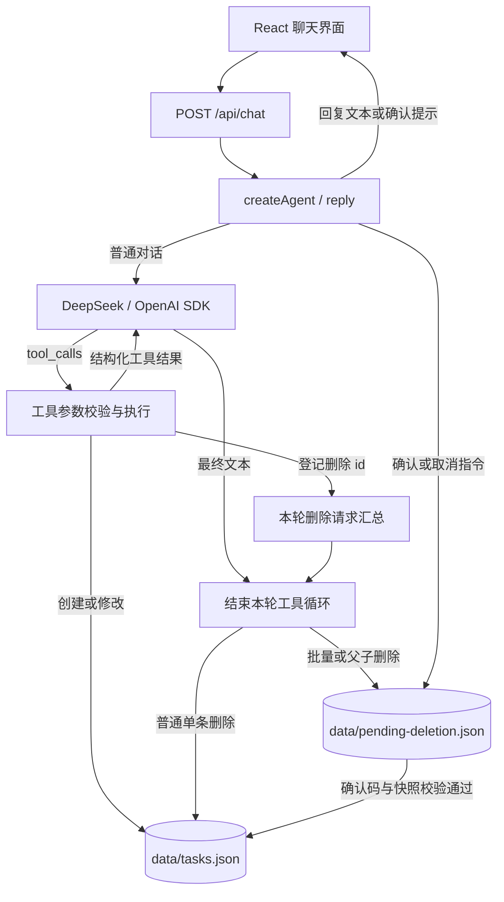

# 小明智能体 · 待办清单

一个用中文对话管理待办任务的本地应用。你可以用自然语言创建、查看、完成、改名和删除任务，也可以设置到期日、优先级、工作量和子任务。

核心由 **OpenAI function calling 工具循环**驱动：模型理解意图并生成工具调用，TypeScript 服务端校验参数、执行操作，再将结果回填给模型。任务保存为本地 JSON 文件，批量删除和含子任务的父任务删除由服务端管理确认流程。

仓库：[xz1028/todo-agent-xiaoming](https://github.com/xz1028/todo-agent-xiaoming)

项目基于 [TokeNow / 小明智能体编程题](https://github.com/TokeNow/todo-agent) 提供的聊天界面、任务 API 和模型客户端开发，核心目标是通过中文对话完成任务的创建、查看、标记完成和删除。原题要求任务在刷新页面或重启服务后仍可查询；扩展功能与实现边界见下文。

## 目录

- [功能概览](#功能概览)
- [快速开始](#快速开始)
- [配置说明](#配置说明)
- [对话示例](#对话示例)
- [架构与执行流程](#架构与执行流程)
- [模型工具](#模型工具)
- [删除确认机制](#删除确认机制)
- [任务数据与持久化](#任务数据与持久化)
- [HTTP API](#http-api)
- [开发与验证](#开发与验证)
- [提交材料](#提交材料)
- [项目结构](#项目结构)
- [已知限制与后续方向](#已知限制与后续方向)
- [常见问题](#常见问题)

## 功能概览

| 能力           | 当前实现                                                         |
| -------------- | ---------------------------------------------------------------- |
| 中文任务管理   | 对话创建、列出、完成、撤销完成、改名和删除任务                   |
| 一句话多条任务 | `add_tasks` 接收标题数组，一次工具调用创建多条任务               |
| 语义匹配       | 通过 system prompt 要求模型先查最新任务，再匹配 id；有歧义时反问 |
| 扩展属性       | 到期日、优先级、工作量和父任务关联                               |
| 到期筛选       | 分别查询今天到期或已逾期的未完成任务；组合筛选的限制见后文       |
| 清单展示       | 工具摘要将未完成任务置顶，显示 ⬜ / ✅、数量统计和属性标签       |
| 删除确认       | 普通单条任务直接删除；批量和父子任务删除需要带确认码的用户指令   |
| 本地持久化     | 任务与待确认删除分别写入 JSON 文件，刷新页面或重启服务后仍保留   |
| 异常兜底       | 缺 key、模型调用失败或超时时返回中文提示；每次模型请求限时 20 秒 |

语义理解、相对日期换算和相似任务消歧依赖模型表现；参数校验、实际任务写入、删除确认和确认过期由服务端代码执行。当前自动化测试使用受控模型响应，不能代替真实模型验收。

## 快速开始

### 1. 准备运行环境

需要 **Node.js >= 24.12.0**，本项目使用 Node 原生运行 TypeScript。Node 22 不满足仓库的版本要求。

已安装 nvm 的环境可以执行：

```sh
nvm install 24
nvm use 24
node --version
```

### 2. 安装依赖

```sh
git clone https://github.com/xz1028/todo-agent-xiaoming.git
cd todo-agent-xiaoming
npm ci
```

以下命令都在仓库根目录执行。数据文件和静态资源的路径按服务进程的工作目录解析。

### 3. 配置模型

首次运行时，从模板创建本地配置文件；已有 `.env` 时保留原文件。

```sh
cp -n .env.example .env
```

编辑 `.env`，填写自己的 `DEEPSEEK_API_KEY`，按需调整 `DEEPSEEK_MODEL`。模板中的 key 默认为空，仓库不包含真实密钥。修改配置后需重启服务。

没有 key 时，服务和任务 REST API 仍可启动使用，自动化测试也不受影响；需要调用模型的聊天请求会返回兜底提示。已有待确认操作的确认或取消由服务端直接处理，无需调用模型。

### 4. 启动应用

```sh
npm run dev
```

浏览器打开 [http://127.0.0.1:3000](http://127.0.0.1:3000)。`predev` 会先构建前端，随后启动带文件监听的 Node 服务。

如果 3000 端口已被占用，在 macOS / Linux 下可指定其他端口：

```sh
PORT=3001 npm run dev
```

也可以先构建，再启动不带文件监听的服务：

```sh
npm run build
npm start
```

`npm run build` 只将前端打包为 `dist/chat.js`；服务端仍由 Node 直接执行 `.ts` 文件。

## 配置说明

| 配置项             | 默认值                  | 用途                                                 |
| ------------------ | ----------------------- | ---------------------------------------------------- |
| `DEEPSEEK_API_KEY` | 空                      | 真实模型调用所需的 key；仅保存在本地环境或 `.env` 中 |
| `DEEPSEEK_MODEL`   | `deepseek-flash`        | 传给模型服务的模型名称                               |
| `PORT`             | `3000`                  | HTTP 服务端口，监听地址固定为 `127.0.0.1`            |
| `BASE_URL`         | `http://127.0.0.1:3000` | 仅供 `scripts/acceptance.ts` 指定待验收的应用地址    |

模型客户端通过 OpenAI SDK 访问 `https://api.deepseek.com`。该地址目前写在 `server/model.ts` 中，没有单独的环境变量开关。`BASE_URL` 不用于修改模型服务地址。

技术栈为 TypeScript、Express 5、React 19、OpenAI SDK、zod、esbuild、node:test、oxlint 和 oxfmt，无 Python 服务或数据库依赖。

## 对话示例

| 你说                                   | 对应意图                                   |
| -------------------------------------- | ------------------------------------------ |
| 帮我记一下买牛奶                       | 新增「买牛奶」                             |
| 再记一下取快递和交报告                 | 一次新增多条任务                           |
| 我有哪些任务？                         | 查看最新清单                               |
| 牛奶买好了                             | 匹配「买牛奶」并标记完成                   |
| 买牛奶还没完成，帮我撤销               | 将对应任务恢复为未完成                     |
| 把交报告改成提交周报                   | 修改标题                                   |
| 提交周报，明天到期，高优先级，工作量大 | 创建带到期日、优先级和工作量的任务         |
| 列出已经逾期的任务                     | 筛选已逾期且未完成的任务                   |
| 给出行任务加个子任务：买车票           | 查询父任务后，通过 `parentId` 创建关联任务 |
| 取快递这条删掉吧                       | 普通单条任务在本轮处理结束后直接删除       |
| 删除买牛奶和取快递                     | 汇总删除范围，显示待确认提示               |

这些是意图示例，具体措辞与任务匹配结果需要真实模型验收。日期换算依据 system prompt 注入的当前日期，时区为 `Asia/Shanghai`。

工具提供的清单摘要格式示例：

```text
共 3 项，未完成 2 项。
⬜ 提交周报 · 截止 2026-11-26 · 优先级 high · 工作量 large
⬜ 取快递
✅ 买牛奶
```

前端支持 Enter 发送、Shift + Enter 换行，并处理中文输入法确认选词的情况。清单按行显示状态，保留回复中的换行。

## 架构与执行流程



普通聊天请求按以下顺序处理：

1. `/api/chat` 校验 `messages`，要求消息非空且最后一条来自用户。
2. agent 组装 system prompt、当前上海日期和客户端传入的对话历史。
3. 调用模型，并提供 6 个 function calling 工具的 schema。
4. 如果模型返回 `tool_calls`，按顺序执行工具，将 JSON 结果以 `role: "tool"` 和对应 `tool_call_id` 回填。
5. 继续调用模型，直到返回最终文本，或达到调用上限。
6. 如果本轮登记了删除，服务端统一判断直接删除或生成确认提示；否则返回模型文本。

完整的确认、取消指令会在调用模型前处理。服务端直接校验待确认记录，因此刷新后没有聊天历史、或服务重启后，也能使用尚未过期的确认码。

单轮最多进行 **6 次模型调用**，每次使用 `AbortSignal.timeout(20_000)` 并设置 `maxRetries: 0`。20 秒是单次调用期限，整轮可能包含多次调用。工具参数错误以结构化结果返回；模型调用异常会记录到服务端控制台并返回中文兜底。

## 模型工具

工具定义和参数校验位于 [server/agent-tools.ts](server/agent-tools.ts)。这些工具供模型调用，与公开的 HTTP 路由不是同一层接口。

| 工具            | 主要参数                                                   | 行为                                       |
| --------------- | ---------------------------------------------------------- | ------------------------------------------ |
| `list_tasks`    | `filter`、`dueToday`、`overdue`                            | 查询任务，返回任务数组和预格式化摘要       |
| `add_tasks`     | `titles`，可选 `dueDate`、`priority`、`effort`、`parentId` | 验证标题与属性后创建任务                   |
| `complete_task` | `id`、可选 `done`                                          | 默认标记完成；`done: false` 撤销完成       |
| `update_task`   | `id`，以及标题或扩展属性                                   | 修改已有任务                               |
| `delete_task`   | `id`、兼容参数 `cascade`                                   | 仅登记删除请求，`cascade: true` 不构成授权 |
| `delete_tasks`  | `ids`                                                      | 验证全部 id、去重并登记批量删除请求        |

`filter` 接受 `all`、`pending` 或 `done`。`dueToday` 和 `overdue` 分别只返回满足日期条件的未完成任务；目前不能通过同时设为 `true` 获取二者并集，详见已知限制。

system prompt 要求涉及已有任务时先调用 `list_tasks`，避免只凭对话历史推断状态。这项调用顺序和语义匹配仍依赖模型遵循提示；实际删除是否需要确认则由服务端独立判断。

## 删除确认机制

删除工具不会立即修改任务文件。agent 会收集同一轮对话中所有删除 id，包括同一条模型消息内的多个工具调用，以及跨多次模型调用登记的删除。

| 实际影响范围                             | 执行方式                         |
| ---------------------------------------- | -------------------------------- |
| 一条没有子任务的普通任务                 | 模型正常结束本轮后直接删除       |
| 多条任务，或父任务及其子任务             | 保存待确认记录，等待用户明确确认 |
| 删除参数错误、模型调用异常或循环达到上限 | 不提交本轮已登记的删除           |

需要确认时，服务端展示待删除任务，并生成带随机确认码的指令：

```text
确认删除 <本次提示中的确认码>
```

如果不再删除，使用同一条提示中的取消指令：

```text
取消删除 <本次提示中的确认码>
```

请复制实际提示中的完整指令，替换上面的占位内容。单独回复「确认」不构成这套服务端机制的授权。

确认记录包含删除目标、任务快照、确认码和过期时间，遵循以下规则：

- **5 分钟有效期**：到期后拒绝执行，需重新发起删除。
- **一次性使用**：执行或取消后，旧确认码不能重放。
- **快照校验**：目标被改名、修改、移除，或关联子任务发生变化时，拒绝执行旧计划。
- **范围固定**：确认期间新增的无关任务不纳入删除范围。
- **一个当前操作**：同一任务清单只保留一个待确认操作，新的删除请求会替换旧操作。
- **重启后可确认**：记录持久化后，确认不依赖旧 agent 实例或浏览器历史。

执行前先清除确认记录，再以一次任务文件替换提交删除。若清除记录失败，则不删除；若之后任务写入失败，需重新发起删除。两份文件之间没有数据库事务。

这套确认机制作用于**模型发起的聊天删除**。直接调用 `DELETE /api/tasks/:id` 仍会立即删除目标及其直接子任务，不经过聊天确认。

## 任务数据与持久化

### 任务字段

| 字段       | 类型 / 可选值                     | 说明                              |
| ---------- | --------------------------------- | --------------------------------- |
| `id`       | `string`                          | 创建时生成的 UUID                 |
| `title`    | `string`                          | 去除首尾空白后长度为 1–200 个字符 |
| `done`     | `boolean`                         | 新任务默认为 `false`              |
| `dueDate`  | 可选 `string`                     | `YYYY-MM-DD` 格式的日期           |
| `priority` | 可选 `high` / `medium` / `low`    | 优先级                            |
| `workload` | 可选 `small` / `medium` / `large` | 存储层统一使用的工作量字段        |
| `parentId` | 可选 `string`                     | 关联父任务 id                     |

`effort` 是工作量的输入别名，工具层和 HTTP 层均接受，并归一化为 `workload`。调用时选用一种命名即可，查询和落盘结果使用 `workload`。

任务文件中的一条记录示例：

```json
{
  "id": "c14bd6dd-4f52-4d60-b2ba-f14bfb5df356",
  "title": "提交周报",
  "done": false,
  "dueDate": "2026-11-26",
  "priority": "high",
  "workload": "large"
}
```

### 本地文件

| 路径                         | 保存内容                        |
| ---------------------------- | ------------------------------- |
| `data/tasks.json`            | 全部任务，文件顶层为数组        |
| `data/pending-deletion.json` | 当前待确认删除；清除后为 `null` |
| `.env`                       | 本地模型配置                    |

JSON 写入采用「写临时文件，再 rename 替换」的方式，避免直接覆盖原文件时留下半截内容。批量删除通过一次任务文件替换完成；旧任务数据中的额外字段会在读写时保留。

`.env`、`data/` 和 `dist/` 已加入 `.gitignore`。任务持久化与聊天历史分开：任务会保留，浏览器内存中的聊天记录刷新后会清空。当前没有聊天历史的服务端存档。

## HTTP API

### 接口概览

| 方法     | 路径             | 请求内容                | 成功响应                    |
| -------- | ---------------- | ----------------------- | --------------------------- |
| `POST`   | `/api/chat`      | `{ "messages": [...] }` | `200`，`{ "reply": "..." }` |
| `GET`    | `/api/tasks`     | 无                      | `200`，任务数组             |
| `POST`   | `/api/tasks`     | `title` 及可选扩展属性  | `201`，新建任务             |
| `PATCH`  | `/api/tasks/:id` | 至少一个有效任务字段    | `200`，更新后的任务         |
| `DELETE` | `/api/tasks/:id` | 无                      | `204`，空响应体             |

REST 任务列表按存储顺序返回；聊天工具的列表与摘要会将未完成项置顶。任务 REST API 不依赖模型 key。任务接口定义可参考 [server/openapi.yaml](server/openapi.yaml)，具体输入校验见 [server/tasks.ts](server/tasks.ts)。

### 发送对话

```sh
curl -sS http://127.0.0.1:3000/api/chat \
  -H 'Content-Type: application/json' \
  -d '{"messages":[{"role":"user","content":"帮我记一下买牛奶"}]}'
```

`messages` 接受 `user` 和 `assistant` 两种角色，内容不能为空，最后一条必须是 `user`。多轮调用时，客户端需将之前的用户消息与助手回复一起传入；服务端不会自动恢复此前对话。

模型不可用时，agent 通常以 `200` 返回包含中文兜底文案的 `reply`；HTTP 成功不代表模型已成功执行任务，可通过 `/api/tasks` 核对实际状态。

### 直接创建和查询任务

```sh
curl -sS http://127.0.0.1:3000/api/tasks \
  -H 'Content-Type: application/json' \
  -d '{"title":"提交周报","dueDate":"2026-11-26","priority":"high","effort":"large"}'

curl -sS http://127.0.0.1:3000/api/tasks
```

### 常见错误响应

| 状态码 | 场景                                              |
| ------ | ------------------------------------------------- |
| `400`  | 无效 JSON、无效字段、空标题或不符合要求的聊天消息 |
| `404`  | 任务 id 不存在，或请求了未定义的 API 路径         |
| `413`  | JSON 请求体超过 1 MB                              |
| `500`  | 未被业务层处理的服务异常                          |

HTTP 错误响应使用 `{ "error": "中文说明" }`。工具执行失败则使用内部的 `{ "ok": false, "error": "..." }` 结果回填，不与 HTTP 错误结构混用。

## 开发与验证

### 常用命令

| 命令                | 用途                                     |
| ------------------- | ---------------------------------------- |
| `npm run dev`       | 先构建前端，再启动服务端文件监听         |
| `npm start`         | 启动服务，不自动构建前端、不监听代码变化 |
| `npm run build`     | 打包前端到 `dist/chat.js`                |
| `npm test`          | 运行 `server/*.test.ts`                  |
| `npm run typecheck` | TypeScript 类型检查                      |
| `npm run lint`      | oxlint 检查                              |
| `npm run fmt:check` | 只检查格式，不写文件                     |

修改 `src/*.tsx` 后，需重新执行 `npm run build` 并刷新浏览器。开发模式会监听服务端文件，但没有前端热更新构建器。

编辑 README 后可以只格式化这个文件：

```sh
./node_modules/.bin/oxfmt --write README.md
```

仓库的 `AGENTS.md` 要求不编辑 `SUBMIT.md`；`npm run fmt` 会写入全目录，维护时应明确限定格式化文件范围。

### 自动化检查

在 Node 24 下执行完整检查：

```sh
npm test && npm run typecheck && npm run lint && npm run fmt:check && npm run build
```

当前测试共 **37 个**，使用临时目录中的真实 JSON 存储、脚本化模型响应，以及受控的 OpenAI SDK 传输。测试不需要真实 API key，覆盖：

- 创建、创建、查看、完成、删除、查看的六步对话及实际任务状态。
- 工具参数边界、标题清理、非法 JSON、不存在的 id 和扩展属性。
- HTTP 任务接口、聊天输入校验及 `effort` 别名兼容。
- 模型错误兜底、调用次数上限、超时中止和禁止自动重试。
- 删除请求汇总、伪造 `cascade`、持久化后重建 agent、过期、取消、重放与快照变化。
- 模型调用失败或工具循环中断时，不提交本轮已登记的删除。

此外，已在隔离临时目录中检查实际服务进程停止、重启后的任务保留，以及通过 HTTP 确认已有删除计划；该检查未访问真实模型服务。

### 基础验收对照

下面的六步来自原题验收场景，按顺序累积对话历史。`server/agent.test.ts` 覆盖相同的操作顺序与实际存储状态，`scripts/acceptance.ts` 用于对运行中的服务检查这些场景。

| 步骤 | 用户输入         | 预期任务状态                             |
| ---- | ---------------- | ---------------------------------------- |
| 1    | 帮我记一下买牛奶 | 新增未完成的「买牛奶」                   |
| 2    | 再记一条取快递   | 清单中有两条未完成任务                   |
| 3    | 我有哪些任务？   | 展示两条任务，并能区分完成状态           |
| 4    | 牛奶买好了       | 「买牛奶」完成，「取快递」仍未完成       |
| 5    | 取快递这条删掉吧 | 删除没有子任务的「取快递」，无需批量确认 |
| 6    | 再给我看看清单   | 只剩已完成的「买牛奶」                   |

持久化还需结合刷新页面、停止并重新启动服务后的查询检查。刷新会清空聊天历史，但应保留任务；重启后应从同一工作目录读取已有任务文件。

### 真实模型验收

填写 `.env` 中的 key 并启动服务后，在另一个终端执行：

```sh
node --env-file-if-exists=.env scripts/acceptance.ts
```

如使用其他端口：

```sh
BASE_URL=http://127.0.0.1:3001 node --env-file-if-exists=.env scripts/acceptance.ts
```

**该脚本会先删除目标服务中的现有任务。请使用专门的验收数据环境。** 它会累积对话历史运行六步基础场景，逐轮打印模型回复和 `/api/tasks` 状态；目前没有完整的语义断言，脚本正常退出也不能代替人工核对结果。

真实验收还应单独检查相似任务消歧、相对日期换算、操作前查询和批量删除确认。当前尚未完成真实 DeepSeek 调用验收。

## 提交材料

按原题要求，提交材料包括公开仓库链接、仓库内的 `SUBMIT.md`，以及可选的交互演示视频。具体提交渠道以 [原题 README](https://github.com/TokeNow/todo-agent#提交) 为准。

- 仓库链接使用本页顶部的 `todo-agent-xiaoming` 地址。
- 运行、配置、已实现功能和验证方式可在本 README 中查阅。
- `SUBMIT.md` 按原题要求由提交者本人撰写和维护；README 中的项目说明不替代该文件。
- 提交前应完成真实模型的基础验收，并如实区分已验证功能、未验证行为与已知限制。

## 项目结构

```text
todo-agent-xiaoming/
├── src/                         # React 聊天界面与请求逻辑
├── public/                      # 页面、样式和图片
├── shared/chat.ts               # 前后端共用的聊天类型与校验
├── server/
│   ├── index.ts                 # 创建任务存储、agent 和 Express 应用
│   ├── app.ts                   # HTTP 路由、静态资源与错误处理
│   ├── agent.ts                 # system prompt、模型调用与工具循环
│   ├── agent-tools.ts           # 6 个工具 schema、参数校验与执行
│   ├── deletion-confirmation.ts # 待确认删除的持久化与状态处理
│   ├── task-store.ts            # JSON 任务存储与批量删除
│   ├── tasks.ts                 # 任务 REST API
│   ├── model.ts                 # DeepSeek 客户端配置
│   ├── openapi.yaml             # 任务 API 定义
│   └── *.test.ts                # 工具、agent 与 HTTP 测试
├── scripts/acceptance.ts        # 真实模型基础验收脚本
├── .env.example                 # 不含真实密钥的配置模板
├── GETTING_STARTED.md           # 本地开发指南
└── DEVELOPMENT.md               # 开发与验证补充说明
```

`server/intent.ts`、`server/model-intent.ts` 和 `server/format.ts` 是旧方案遗留文件，当前 `server/index.ts → agent.ts` 主调用链不经过这些模块。

`createAgent({ tasks, client?, model?, now?, confirmationFile? })` 支持注入任务存储、模型客户端和时间。生产入口指定确认文件路径；测试不传 `confirmationFile` 时，待确认状态只保留在该 agent 实例内。

## 已知限制与后续方向

| 当前限制                                                                                               | 后续方向                                     |
| ------------------------------------------------------------------------------------------------------ | -------------------------------------------- |
| `dueToday`、`overdue` 同时为 `true` 时依次过滤，形成交集并返回空列表，尚未实现「今天到期或逾期」的并集 | 修正组合筛选并补充并集回归测试               |
| 相对日期换算、相似任务消歧和操作前查询仍依赖模型遵循提示，真实 DeepSeek 行为尚未验收                   | 补充真实模型验收与结果断言                   |
| 日期字段目前只验证 `YYYY-MM-DD` 形式，不校验完整的日历合法性                                           | 增加真实日期校验                             |
| 任务列表和聊天历史没有分页、字段裁剪或自动摘要                                                         | 控制长清单与长对话的上下文大小               |
| 浏览器刷新后聊天历史清空，跨会话指代不保留                                                             | 增加会话标识与历史持久化                     |
| 子任务按直接父子关系处理，缺少父任务存在性、循环引用与深层关系校验；父任务状态不自动推导               | 完善关系约束、层级展示与完成度计算           |
| 本地单用户、单服务进程设计，没有登录和多用户数据隔离；同一清单仅保留一个待确认操作                     | 按需要引入身份、会话隔离与适合并发写入的存储 |
| 创建、修改等工具会即时落盘；整轮对话不具备事务回滚，模型后续出错时可能已有部分变更                     | 在需要时引入操作计划或事务边界               |

## 常见问题

**为什么可以打开页面，却一直提示连不上大模型？**

客户端在首次需要模型时才创建。检查 Node 版本、`.env` 中的 key、模型名称和网络连通性，修改配置后重启服务。具体异常记录在启动服务的终端中。

**为什么改了前端代码，刷新页面仍然没变化？**

页面加载的是 `dist/chat.js`。重新执行 `npm run build` 后再刷新；只重启服务不会自动重建前端。

**为什么重启后看不到原来的任务？**

先确认仍从同一个仓库根目录启动服务。`data/tasks.json` 相对于进程工作目录解析，从其他目录启动会读取另一处数据文件。

**为什么回复里说处理失败，清单却已经有变化？**

新增、修改和完成操作在工具执行时就会落盘，后续模型调用失败不会回滚它们。可通过任务 API 核对实际状态。本轮尚未提交的删除计划则不会在模型异常后执行。

**为什么确认码失效了？**

可能已过 5 分钟、已执行或取消、被新的删除请求替换，或目标任务发生了变化。重新发起删除，核对最新范围后使用新提示中的完整指令。

更多本地开发细节见 [GETTING_STARTED.md](GETTING_STARTED.md)，验证与实现说明见 [DEVELOPMENT.md](DEVELOPMENT.md)。
